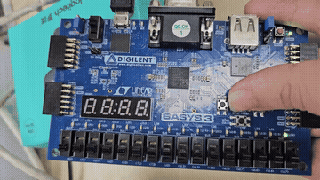

# 버튼 디바운싱과 LED 왕복 FSM

[전체 프로젝트 목록](../README.md)

버튼 입력을 안정화하고 누를 때마다 LED 위치를 왕복 이동시킵니다.

## 동작과 설계

```text
btnC → debouncer → clean_btn → 상승 에지 검출 → led_fsm → led[4:0]
```

100 MHz에서 기본 디바운싱 임계값은 999,999이며 약 10 ms 동안 안정된 입력을 반영합니다. LED 위치는 버튼을 누를 때마다 `0 → 1 → 2 → 3 → 2 → 1 → 0 → …`으로 이동합니다. `led[3:0]`은 one-hot 위치, `led[4]`는 역방향 상태입니다. 출력은 `next_state`, `next_dir`를 참조합니다.

보드에서는 SW15(R2)를 1로 올렸다 내린 뒤 중앙 버튼 `btnC`(U18)를 반복해서 누릅니다. `clk`는 W5, 주기는 10 ns입니다.

## 실행 구성

- **Design Top:** `top_btn_debounce`
- **Design Sources:**
  - [top_btn_debounce.v](sources_1/btn_debounce/top_btn_debounce.v)
  - [led_toggle.v](sources_1/btn_debounce/led_toggle.v)
  - [btn_debounce_10ms.v](sources_1/btn_debounce_10ms.v)
- **보드 제약:** [Basys 3 XDC](constrs_1/Basys3-Master_orginal.xdc)

Vivado 프로젝트 생성과 합성·보드 실행 절차는 [공통 실행 방법](../README.md#실행-방법)을 따릅니다. 위 소스만 Design Sources에 추가하고 테스트벤치는 Simulation Sources에 분리합니다.

## 시뮬레이션

| 테스트벤치 | Simulation Top | 확인 범위 / 상태 |
| --- | --- | --- |
| [tb_led_fsm.v](sim_1/tb_led_fsm.v) | `tb_led_fsm` | 디바운서 제외, LED FSM 상태 및 출력 검사 |

## 보고서와 시연 자료

GIF로 동작을 미리 보고, MP4로 전체 영상과 소리를 확인할 수 있습니다.

| 자료 | 파일명 |
| --- | --- |
| [LED FSM 구현 보고서](docs/report.pdf) | `led fsm melay machine 구현.pdf` |
| [LED FSM 시연 영상](media/demo.mp4?raw=true) | `led_fsm_동작동영상.mp4` |

[](media/demo.mp4?raw=true)

## 현재 상태와 주의사항

`button_debounce.v`와 `btn_debounce_10ms.v`는 모두 `debouncer`를 정의합니다. 위의 세 파일만 선택하면 중복 정의를 피할 수 있습니다. 하위 폴더의 `clock_80hz.v`, `d_ff.v`, `btn_debounce.v`는 별도 샘플링 방식의 실습 소스이며 현재 Top에서 사용하지 않습니다.
