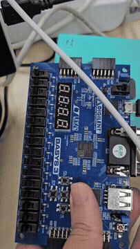

# Moore FSM 101 검출기

[전체 프로젝트 목록](../README.md)

입력 패턴 101을 상태 전이로 검출하고 검출 상태에서 LED를 켭니다.

## 동작과 설계

```text
btnU / btnD → 각 버튼 debouncer → 상승 에지 검출 → 4상태 Moore FSM → led
```

U 입력은 1, D 입력은 0입니다. 디바운싱된 버튼을 누르는 순간에만 상태를 갱신합니다. 기본 검출 경로는 `s0 → s1(1) → s2(10) → s3(101)`이며 `y = (curr_state == s3)`입니다. 다음 입력까지 검출 상태와 출력이 유지됩니다.

`s3`에서 0을 입력하면 `s2`로 이동하므로 `10101` 같은 중첩 패턴도 처리하도록 설계되어 있습니다. SW15(R2)로 리셋한 뒤 U-D-U 순서로 입력하고 LED0(U16)을 관찰합니다. U/D 핀은 T18/U17, 클럭은 W5(100 MHz)입니다.

## 실행 구성

- **Design Top:** `top_moore_fsm`
- **Design Sources:**
  - [top_moore_fsm.v](sources_1/top_moore_fsm.v)
  - [moor_fsm_101.v](sources_1/moor_fsm_101.v)
  - [btn_debounce_10ms.v](sources_1/btn_debounce_10ms.v)
- **보드 제약:** [Basys 3 XDC](constrs_1/Basys3-Master_orginal.xdc)

Vivado 프로젝트 생성과 합성·보드 실행 절차는 [공통 실행 방법](../README.md#실행-방법)을 따릅니다. 위 소스만 Design Sources에 추가하고 테스트벤치는 Simulation Sources에 분리합니다.

## 시뮬레이션

| 테스트벤치 | Simulation Top | 확인 범위 / 상태 |
| --- | --- | --- |
| [tb_moore_fsm_101.v](sim_1/tb_moore_fsm_101.v) | `tb_moore_fsm_101` | 현재 DUT 포트와 불일치하여 수정 필요 |

## 보고서와 시연 자료

GIF로 동작을 미리 보고, MP4로 전체 영상과 소리를 확인할 수 있습니다.

| 자료 | 파일명 |
| --- | --- |
| [Moore 소스 보고서](docs/moore-source.pdf) | `moore_fsm_101_sourcecode.pdf` |
| [Moore 시연 영상](media/demo.mp4?raw=true) | `moore_동작동영상.mp4` |

[](media/demo.mp4?raw=true)

[Moore·Mealy 통합 소스 보고서](../08.melay_fsm_101/docs/moore-mealy-source.pdf)도 함께 참고할 수 있습니다.

## 현재 상태와 주의사항

현재 테스트벤치는 `.x(x)`를 연결하지만 RTL은 `x1`, `x2`를 받습니다. 버튼 에지 형태의 자극으로 수정하기 전에는 실행할 수 없습니다.
