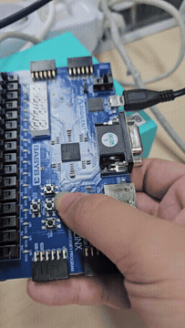
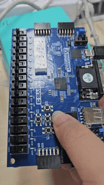

# 시프트 레지스터와 FSM 패턴 검출

[전체 프로젝트 목록](../README.md)

101 및 1010111 검출을 두 가지 구조로 구현하고 비교합니다.

## 동작과 설계

```text
btnU / btnD → debouncer → 버튼 해제 이벤트 + 비트 값
                           → 7비트 shift register → 1010111 비교 → led[15]
```

U를 눌렀다 떼면 1, D를 눌렀다 떼면 0을 입력합니다. 두 버튼을 동시에 조작하지 않고 각 입력 사이에 디바운싱 시간을 둡니다. SW15(R2)로 리셋한 뒤 U-D-U-D-U-U-U 순서로 입력하면 최근 7비트가 `1010111`이 됩니다. `led[6:0]`은 입력 이력, `led[15]`는 일치 여부, `led[14:7]`은 0입니다. 검출 출력은 다음 입력 전까지 유지됩니다.

| 모듈 | 구조 / 출력 |
| --- | --- |
| `shift_register` | 최근 3비트 비교, `101` 검출 |
| `moor_fsm_101` | 4상태 Moore FSM, `101` 검출 |
| `my_shiftreg_1010111_detect` | 최근 7비트 비교, 현재 Top에 연결 |
| `my_fsm_1010111_detect` | 8상태 Moore FSM, 상태는 LED[2:0], 검출은 LED[15] |

FSM 방식은 접두 패턴의 진행 상태를 저장하고, 시프트 방식은 최근 입력 자체를 저장합니다. 자원 사용량과 타이밍의 정량 비교 결과는 아직 포함되어 있지 않습니다.

## 실행 구성

- **Design Top:** `top_fsm`
- **Design Sources:**
  - [top_moor_fsm.v](sources_1/top_moor_fsm.v)
  - [btn_debounce10ms.v](sources_1/btn_debounce10ms.v)
  - [btn_U1D0_check.v](sources_1/btn_U1D0_check.v)
  - [my_shiftreg_1010111_detect.v](sources_1/my_shiftreg_1010111_detect.v)
- **보드 제약:** [Basys 3 XDC](constrs_1/Basys3-Master_orginal.xdc)

Vivado 프로젝트 생성과 합성·보드 실행 절차는 [공통 실행 방법](../README.md#실행-방법)을 따릅니다. 위 소스만 Design Sources에 추가하고 테스트벤치는 Simulation Sources에 분리합니다.

## 시뮬레이션

| 테스트벤치 | Simulation Top | 확인 범위 / 상태 |
| --- | --- | --- |
| [tb_shift_register.v](sim_1/tb_shift_register.v) | `tb_shift_register` | 7비트 시프트 검출기 단위 테스트, 기대 메시지 TEST PASS! |

문서 작성 과정에서 시뮬레이션을 새로 실행하지 않았습니다. PASS/FAIL 문구는 테스트벤치가 기대하는 결과이며 실제 재실행 결과와 구분합니다.

## 보고서와 시연 자료

제공받은 구현 자료의 사본입니다. PDF·영상이 현재 RTL과 동일한 버전인지까지 대조 검증한 것은 아닙니다. 영상 미리보기는 전체 영상의 움직이는 GIF입니다. MP4는 브라우저 호환성을 위해 H.264/AAC로 변환했으며, 원본 파일은 저장소 밖의 제공 위치에 보존되어 있습니다.

| 자료 | 제공 원본명 |
| --- | --- |
| [시프트 레지스터·FSM 구현 보고서](docs/report.pdf) | `my_shiftreg_1010111_detect my_fsm_1010111_detect 구현 하기.pdf` |
| [FSM 구현 시연 영상](media/fsm-demo.mp4?raw=true) | `fsm_동작동영상.mp4` |
| [시프트 레지스터 시연 영상](media/shift-register-demo.mp4?raw=true) | `shift_register_동작동영상.mp4` |

[](media/fsm-demo.mp4?raw=true)

[](media/shift-register-demo.mp4?raw=true)

## 현재 상태와 주의사항

Top 파일명은 `top_moor_fsm.v`이지만 모듈명은 `top_fsm`입니다. 현재 나머지 검출기의 인스턴스는 주석 처리되어 있습니다. FSM 방식으로 바꾸려면 현재 인스턴스를 비활성화하고 `my_fsm_1010111_detect` 인스턴스를 활성화한 뒤 해당 소스를 추가합니다. 하나의 LED 출력을 여러 검출기가 동시에 구동하지 않도록 합니다. 제공 테스트벤치는 디바운서와 FSM 대안 구현을 검사하지 않습니다.
