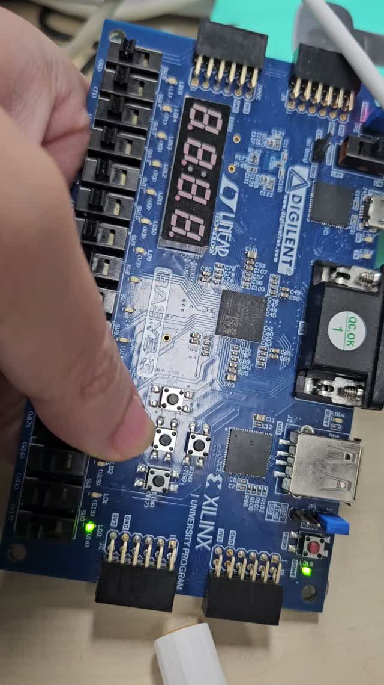

# Mealy FSM 101 검출기

[전체 프로젝트 목록](../README.md)

현재 상태와 입력 이벤트를 함께 사용해 마지막 1 입력 시 검출 신호를 생성합니다.

## 동작과 설계

상태는 `S0(대기)`, `S1(1)`, `S2(10)` 세 개입니다. 디바운싱된 U 버튼의 상승 에지를 1, D 버튼의 상승 에지를 0으로 처리합니다. `S2`에서 1 이벤트를 받으면 `y=1`을 만들고 `S1`로 돌아가 중첩 검출을 준비합니다.

```text
버튼 → 디바운서 → Mealy FSM(y, btn_event) → 출력 저장 레지스터 → led
```

Top은 `y`를 받으면 LED를 켜고, 이후 검출이 아닌 버튼 이벤트가 들어오면 끕니다. 이 출력 저장 로직 덕분에 짧은 검출 이벤트도 보드에서 관찰할 수 있습니다. SW15(R2)로 리셋 후 U-D-U 순서로 누릅니다. U/D는 T18/U17, LED는 U16, 클럭은 W5(100 MHz)입니다.

## 실행 구성

- **Design Top:** `top_melay_fsm_101`
- **Design Sources:**
  - [top_melay_fsm_101.v](sources_1/top_melay_fsm_101.v)
  - [melay_fsm_101.v](sources_1/melay_fsm_101.v)
  - [btn_debounce_10ms.v](sources_1/btn_debounce_10ms.v)
- **보드 제약:** [Basys 3 XDC](constrs_1/Basys3-Master_orginal.xdc)

Vivado 프로젝트 생성과 합성·보드 실행 절차는 [공통 실행 방법](../README.md#실행-방법)을 따릅니다. 위 소스만 Design Sources에 추가하고 테스트벤치는 Simulation Sources에 분리합니다.

## 시뮬레이션

| 테스트벤치 | Simulation Top | 확인 범위 / 상태 |
| --- | --- | --- |
| [tb_moore_fsm_101.v](sim_1/tb_moore_fsm_101.v) | `tb_melay_fsm_101` | 현재 DUT 포트와 불일치하여 수정 필요 |

문서 작성 과정에서 시뮬레이션을 새로 실행하지 않았습니다. PASS/FAIL 문구는 테스트벤치가 기대하는 결과이며 실제 재실행 결과와 구분합니다.

## 보고서와 시연 자료

제공받은 구현 자료의 사본입니다. PDF·영상이 현재 RTL과 동일한 버전인지까지 대조 검증한 것은 아닙니다. 영상 미리보기는 원본 2초 지점의 프레임입니다.

| 자료 | 제공 원본명 |
| --- | --- |
| [Moore·Mealy 소스 보고서](docs/moore-mealy-source.pdf) | `moore_fsm & melay_fsm source_code.pdf` |
| [Mealy 시연 영상](media/demo.mp4) | `melay_동작동영상.mp4` |

[](media/demo.mp4)

## 현재 상태와 주의사항

테스트벤치 파일명에는 `moore`가 있지만 모듈명은 `tb_melay_fsm_101`입니다. 또한 `.x(x)`를 연결하여 현재 RTL의 `x1`, `x2`와 맞지 않습니다. 인터페이스와 Mealy 출력의 관찰 시점을 수정해야 합니다. 기존 영상이 현재 테스트벤치의 실행 성공을 보장하지는 않습니다.
