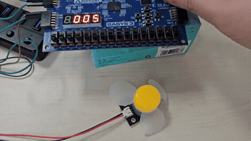
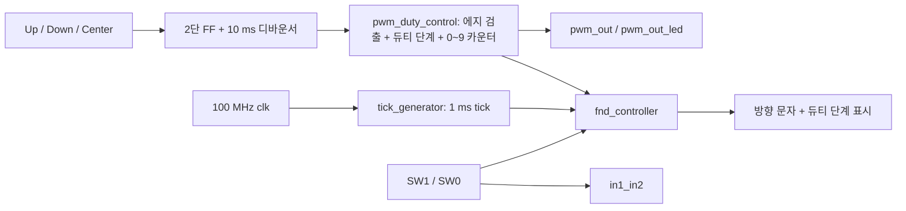
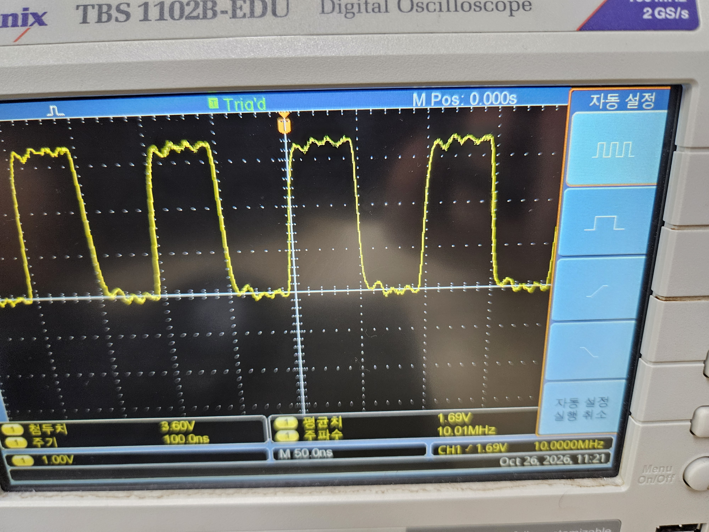
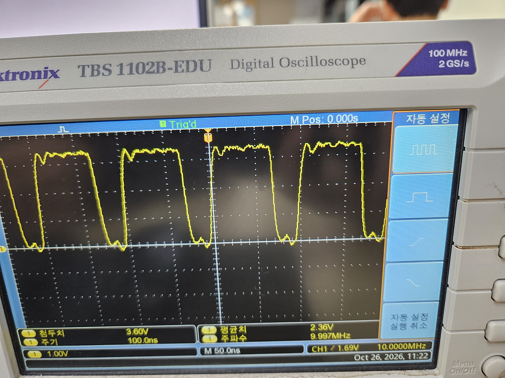
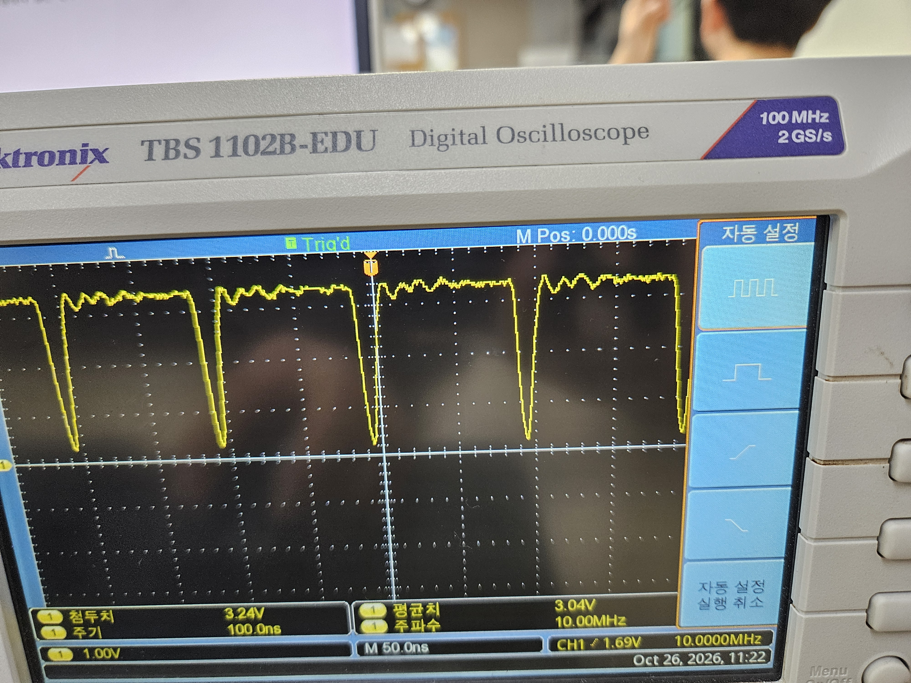

# DC 모터 PWM 제어

[전체 프로젝트 목록](../README.md)

Basys 3의 100 MHz 클럭으로 10 MHz PWM을 생성하고, 버튼으로 듀티를 10% 단위로 조절하는 실습입니다. 두 스위치 값을 모터 방향 제어 출력으로 전달하고, 4자리 FND에 방향 문자와 듀티 단계를 표시합니다.

## 보고서와 시연

| 자료 | 내용 |
| --- | --- |
| [구현 보고서](docs/report.pdf) | FND 제어 코드와 PWM 측정 결과, 6페이지 |
| [시연 영상 열기·다운로드](media/demo.mp4?raw=true) | PWM 제어 시연, 약 9.6초 |
| [측정 사진 1](media/20261026_115203.jpg) | PWM 파형 및 주파수 측정 |
| [측정 사진 2](media/20261026_115206.jpg) | 듀티 변경에 따른 파형 비교 |
| [측정 사진 3](media/20261026_115209.jpg) | High 구간이 증가한 PWM 파형 |

아래 GIF는 전체 시연 영상의 저해상도 미리보기입니다. 소리와 더 높은 해상도는 MP4에서 확인합니다. 다운로드가 시작되면 저장한 파일을 재생하세요.

[](media/demo.mp4?raw=true)

## 기능과 조작

| 입력 | 기능 |
| --- | --- |
| SW15 (`reset`) | active-high 리셋, 듀티 단계 5(50%)로 초기화 |
| Up (`btn[0]`) | 한 번 누를 때 듀티 단계 +1, 최대 9(90%) |
| Down (`btn[1]`) | 한 번 누를 때 듀티 단계 -1, 최소 0(0%) |
| Center (`btn[2]`) | 디바운서에는 연결되지만 현재 PWM 제어에서는 사용하지 않음 |
| SW1·SW0 (`sw[1:0]`) | `in1_in2[1:0]` 방향 제어 출력으로 그대로 전달 |

버튼은 2단 FF 동기화와 약 10 ms 디바운싱을 거칩니다. Up/Down은 상승 에지를 검출하므로 계속 누르고 있어도 한 단계만 변경됩니다. 리셋은 정지 명령이 아니라 50% 듀티 초기화입니다.

### 듀티와 PWM 주기

`r_pwm_counter`가 0~9를 반복하고, `r_pwm_counter < r_duty_cycle`일 때 출력이 1이 됩니다.

```text
PWM 주파수 = 100 MHz / 10 = 10 MHz
PWM 주기   = 100 ns
듀티       = duty_cycle / 10 × 100%
High 시간  = duty_cycle × 10 ns
```

| 단계 | 듀티 | High 시간 | FND 숫자 세 자리 |
| --- | --- | --- | --- |
| 0 | 0% | 0 ns, 출력 Low 유지 | `000` |
| 5 (기본값) | 50% | 50 ns | `005` |
| 7 | 70% | 70 ns | `007` |
| 8 | 80% | 80 ns | `008` |
| 9 | 90% | 90 ns | `009` |

100% 단계는 구현되어 있지 않습니다. `pwm_out_led`는 PWM과 동일한 신호이며, RPM을 측정하거나 목표 속도를 유지하는 피드백 제어는 포함되어 있지 않습니다.

### 방향과 FND 표시

| `sw[1:0]` | `in1_in2[1:0]` | FND 왼쪽 자리 |
| --- | --- | --- |
| `10` | `10` | `F` |
| `01` | `01` | `b` |
| `00` / `11` | 입력 값 그대로 | 공백 |

방향 문자는 1초 ON / 1초 OFF로 점멸합니다. 나머지 세 자리는 백분율이 아닌 **듀티 단계 000~009**를 표시합니다. FND는 1 ms마다 한 자리씩 선택하여 4 ms에 전체 자리를 순환하고, `seg`와 `an`은 active-low입니다.

실제 회전 방향과 `00`·`11`의 제동/정지 동작은 외부 드라이버와 배선에 따라 달라집니다. 이 RTL은 스위치 값을 그대로 내보내며 방향 전환 지연이나 모터 드라이버 보호 로직은 구현하지 않습니다.

## 설계 구조



PWM은 100 MHz 클럭으로 직접 계수합니다. `tick_generator`의 1 ms tick은 FND 스캔에 사용되며 PWM 주파수를 결정하지 않습니다.

## 소스와 실행 구성

Verilog 모듈 5개와 Basys 3 핀·타이밍 제약으로 구성됩니다.

```text
10.pwm_control/
├── README.md
├── sources_1/
│   ├── top.v
│   ├── pwm_duty_control.v
│   ├── btn_debounce10ms.v
│   ├── tick_generator.v
│   └── fnd_controller.v
├── constrs_1/Basys3-Master_orginal.xdc
├── docs/report.pdf
└── media/                  # MP4, GIF, 오실로스코프 사진 3장
```

| 파일 | 역할 |
| --- | --- |
| [top.v](sources_1/top.v) | 전체 모듈 연결과 방향 출력 |
| [pwm_duty_control.v](sources_1/pwm_duty_control.v) | 듀티 증감 및 10 MHz PWM 생성 |
| [btn_debounce10ms.v](sources_1/btn_debounce10ms.v) | `btn_debouncer`, `debouncer` 정의 |
| [tick_generator.v](sources_1/tick_generator.v) | 1 ms 표시용 tick |
| [fnd_controller.v](sources_1/fnd_controller.v) | 숫자 변환, 자리 선택, 방향 문자 점멸 |
| [Basys 3 XDC](constrs_1/Basys3-Master_orginal.xdc) | 입출력 핀과 10 ns 클럭 제약 |

1. Vivado에서 Basys 3 (`xc7a35tcpg236-1`) RTL 프로젝트를 생성합니다.
2. 위 Verilog 다섯 파일을 Design Sources에 추가하고 **`top`을 Design Top**으로 지정합니다.
3. XDC를 추가하고 Synthesis → Implementation → Generate Bitstream을 수행합니다.
4. Hardware Manager로 프로그램한 뒤 SW15를 1로 올렸다가 0으로 내려 초기화합니다.
5. Up/Down으로 단계 변화, SW1/SW0로 방향 표시, 오실로스코프로 PWM 출력의 주기와 펄스 폭을 확인합니다.

### 핀 배치

| 포트 | 핀 / 보드 위치 |
| --- | --- |
| `clk` | W5, 100 MHz |
| `reset` | R2, SW15 |
| `btn[0]`, `btn[1]`, `btn[2]` | T18(Up), U17(Down), U18(Center) |
| `sw[0]`, `sw[1]` | V17(SW0), V16(SW1) |
| `pwm_out` | J1, JA1 |
| `in1_in2[0]`, `in1_in2[1]` | L2(JA2), J2(JA3) |
| `pwm_out_led` | U16, LED0 |
| `seg[0]`~`seg[7]` | W7, W6, U8, V8, U5, V5, U7, V7 |
| `an[0]`~`an[3]` | U2, U4, V4, W4 |

## 오실로스코프 측정 기록

세 사진 모두 화면에 약 **100 ns 주기, 10 MHz 주파수**가 표시되어 있습니다. 순서대로 High 구간이 길어지는 모습을 비교할 수 있습니다.

| 사진 | 화면 표시 주파수 | 화면 표시 평균 전압 |
| --- | --- | --- |
| `20261026_115203.jpg` | 10.01 MHz | 1.69 V |
| `20261026_115206.jpg` | 9.997 MHz | 2.36 V |
| `20261026_115209.jpg` | 10.00 MHz | 3.04 V |

100 MHz 입력 클럭에서 PWM 카운터가 0~9를 반복하도록 설계하여 출력 주파수를 **10 MHz**, 주기를 **100 ns**로 설정했습니다. 사진에서도 약 10 MHz의 주파수와 100 ns 주기가 관찰됩니다. 듀티 단계를 높이면 주기는 유지되고 High 구간이 길어집니다. 보고서에는 듀티 70%·80%·90%의 파형 비교를 정리했습니다.







## 검증 범위와 현재 구현 특성

- 전용 테스트벤치는 포함되어 있지 않습니다. 보드 시연 영상과 오실로스코프 사진으로 동작을 기록했으며, 자동 테스트 결과와 합성·타이밍 분석 결과는 별도로 수록하지 않았습니다.
- Up과 Down의 처리가 독립된 두 `if`문이므로 두 버튼을 동시에 누르면 현재 단계와 대입 순서에 따라 결과가 달라집니다. 한 번에 하나의 버튼으로 조작합니다.
- 듀티 갱신을 PWM 주기 경계까지 지연하지 않으므로 조절 순간의 펄스 폭은 전환 중 값일 수 있습니다. 정상 주기와 변경 순간을 구분해 관찰합니다.
- 방향 스위치는 동기화·디바운싱 없이 출력에 직접 연결됩니다. 안정된 방향 전환이 필요한 응용에는 별도 제어가 필요합니다.
