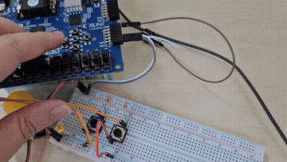
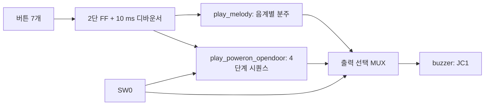

# PWM 부저 음계·효과음 재생

[전체 프로젝트 목록](../README.md)

100 MHz 클럭을 분주해 부저용 구형파를 생성하고, 버튼으로 음계와 4단계 효과음을 재생하는 Basys 3 프로젝트입니다. SW0으로 일반 음계 모드와 전원·문 열림 효과음 모드를 선택합니다.

## 보고서와 시연

- [구현 보고서](docs/report.pdf): 효과음 제어 코드, Top 연결, 테스트벤치와 시뮬레이션 파형
- [소리 포함 시연 영상](media/demo.mp4?raw=true): 약 12.7초, H.264/AAC MP4

부저 소리는 MP4에서 확인할 수 있습니다. 링크에서 다운로드가 시작되면 저장한 파일을 재생하세요. GIF는 보드 조작 미리보기입니다.

[](media/demo.mp4?raw=true)

## 동작과 조작

| 입력 | SW0=0: 일반 음계 | SW0=1: 효과음 |
| --- | --- | --- |
| Up / `btn[0]` | 도 | 사용하지 않음 |
| Left / `btn[1]` | 레 | L 시퀀스 시작 |
| Center / `btn[2]` | 미 | 사용하지 않음 |
| Right / `btn[3]` | 파 | R 시퀀스 시작 |
| Down / `btn[4]` | 솔 | 사용하지 않음 |
| 외부 버튼 / `btn[5]` | 라, active-low | 사용하지 않음 |
| 외부 버튼 / `btn[6]` | 시, active-low | 사용하지 않음 |
| SW15 / `reset` | 카운터와 출력 초기화 | 재생 중단 및 초기화 |

일반 음계는 버튼을 누르는 동안 재생합니다. 보드 버튼 5개는 active-high, 외부 버튼 2개는 풀업 입력을 사용하는 active-low입니다. 모든 버튼은 2단 FF 동기화와 약 10 ms 디바운싱을 거칩니다.

효과음은 네 음을 순서대로 재생하며, 시작한 뒤에는 버튼을 놓아도 끝까지 진행합니다. 재생 중 다른 효과음 입력은 처리하지 않습니다. SW0을 0으로 내리면 효과음이 중단되고 일반 음계 출력으로 전환됩니다. 전원·문 열림 상황을 버튼으로 재현하는 방식으로, 실제 전원 감지나 도어 센서 입력은 없습니다.

## 음 생성과 재생 시간

### 일반 음계

`play_melody`는 음별 카운터가 `N-1`에 도달하면 출력을 반전합니다. 출력의 High와 Low 길이는 같으며 듀티는 50%입니다.

```text
음 주파수 = 100,000,000 / (2 × N)
```

| 음 | 반주기 카운트 N | 주파수(약) |
| --- | --- | --- |
| 도 | 191,112 | 261.63 Hz |
| 레 | 170,261 | 293.67 Hz |
| 미 | 151,685 | 329.63 Hz |
| 파 | 143,172 | 349.23 Hz |
| 솔 | 127,552 | 392.00 Hz |
| 라 | 113,635 | 440.01 Hz |
| 시 | 101,237 | 493.89 Hz |

음별 출력을 축약 OR로 합칩니다. 여러 버튼을 동시에 누르면 해당 구형파의 OR 결과가 출력됩니다.

### 4단계 효과음

`play_poweron_opendoor`는 선택한 임계값 K까지 계수한 뒤 출력을 반전하므로 주파수는 `100,000,000 / (2 × (K+1))`입니다.

| 단계 | L 임계값 / 주파수(약) | R 임계값 / 주파수(약) |
| --- | --- | --- |
| 1 | 49,999 / 1,000 Hz | 191,112 / 261.63 Hz |
| 2 | 24,999 / 2,000 Hz | 151,685 / 329.63 Hz |
| 3 | 16,666 / 2,999.94 Hz | 127,552 / 391.99 Hz |
| 4 | 12,499 / 4,000 Hz | 90,252 / 554.00 Hz |

단계 시간 카운터 `r_cnt`는 0~6,999,999를 계수합니다. **한 음은 70 ms, 네 음 전체는 약 280 ms**이며 단계 전환 시 음 생성 카운터와 출력을 0으로 초기화합니다. `r_play`는 재생 상태, `r_mod`는 L/R 선택, `r_step_l`과 `r_step_r`은 현재 단계를 저장합니다.

## 설계 구조



## 파일과 실행 구성

| 파일 | 역할 |
| --- | --- |
| [top_buzzer.v](sources_1/top_buzzer.v) | 디바운서·음계·효과음 연결, SW0에 따른 출력 선택 |
| [play_melody.v](sources_1/play_melody.v) | 7개 음계의 50% 듀티 구형파 생성 |
| [play_poweron_opendoor.v](sources_1/play_poweron_opendoor.v) | L/R 효과음 선택, 단계 진행, 재생 종료 |
| [btn_debounce10ms.v](sources_1/btn_debounce10ms.v) | 버튼 7개 동기화 및 디바운싱 |
| [tb_buzzer.v](sim_1/tb_buzzer.v) | 모드 전환과 Left 버튼 재생 시나리오 |
| [Basys 3 XDC](constrs_1/Basys3-Master_orginal.xdc) | 보드 핀 배치 및 10 ns 클럭 제약 |

Vivado의 Design Sources에 위 RTL 네 파일을 추가하고 **Design Top을 `top_buzzer`**로 설정합니다. 테스트벤치는 Simulation Sources에 추가하고 **Simulation Top을 `tb_buzzer`**로 지정합니다. 보드 실행에는 XDC를 추가합니다. 합성 전에 아래 LED 연결 항목을 확인하세요. [공통 실행 방법](../README.md#실행-방법)

### 핀 배치

| 신호 | 핀 / 기능 |
| --- | --- |
| `clk` | W5 / 100 MHz |
| `reset` | R2 / SW15, active-high |
| `sw` | V17 / SW0 |
| `btn[0]`~`btn[4]` | T18(Up), W19(Left), U18(Center), T17(Right), U17(Down) |
| `btn[5]`, `btn[6]` | J3, L3 / 외부 풀업 버튼 |
| `buzzer` | K17 / JC1 |
| `led[0]`, `led[1]` | U16, E19 |

## 테스트벤치

`tb_buzzer`는 10 ns 주기의 클럭과 전체 Top을 사용합니다. 외부 버튼의 유휴 입력은 `btn=7'b1100000`입니다.

1. 리셋 해제 후 SW0=0에서 Left를 100 ms 누르고 100 ms 대기합니다.
2. SW0=1에서 Left를 100 ms 누른 뒤 버튼을 놓고 300 ms 대기합니다.
3. SW0=0으로 복귀한 뒤 Left를 다시 100 ms 누르고 100 ms 대기합니다.

파형에서 일반 음계 출력, 버튼 해제 후 효과음의 지속 재생, 네 단계 종료와 일반 모드 복귀를 관찰합니다. 보고서 7페이지에 해당 시뮬레이션 파형이 있습니다. 테스트벤치는 파형 확인 방식이며 Right 시퀀스와 외부 버튼 입력은 별도 자극이 필요합니다.

## 현재 코드의 확인 사항

- **Right 버튼 이전 상태:** `r_btn_prev <= btn[1]` 대입으로 `r_btn_prev[1]`은 0이 됩니다. Right를 재생 종료까지 누르고 있으면 다음 시퀀스가 다시 시작될 수 있습니다. Right도 상승 에지로 처리하려면 이전 상태를 `{btn[3], btn[1]}`로 저장해야 합니다.
- **LED 출력 연결:** Top에서 두 재생 모듈의 `led` 출력을 같은 선에 연결합니다. 일반 모드에서는 `play_melody`의 `led[0]=1`과 효과음 모듈의 `led=00`이 충돌합니다. LED는 Top에서 한 번만 할당하거나 모드에 따라 선택하도록 정리해야 합니다.
- **외부 버튼 초기 상태:** 디바운서 출력의 리셋값은 0이므로 active-low 외부 버튼은 리셋 해제 후 입력이 안정될 때까지 잠시 눌림 상태로 해석될 수 있습니다.
