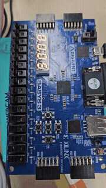
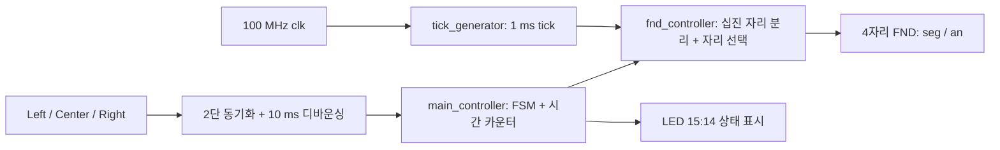

# FPGA 분·초 시계 & 스톱워치

[전체 프로젝트 목록](../README.md)

Basys 3의 100 MHz 클럭을 이용해 분·초 시계와 10 ms 단위 스톱워치를 구현했습니다. 세 버튼으로 모드 전환·초기화·일시정지를 제어하고, 4자리 FND와 LED로 시간 및 상태를 표시합니다. 일시정지 후 3초간 입력이 없으면 FND 테두리 애니메이션이 실행됩니다.

## 발표자료와 보드 시연

| 자료 | 제공 원본 | 저장 형식 |
| --- | --- | --- |
| [발표자료 다운로드](docs/minsec-stopwatch.pptx?raw=true) | `FPGA_분초시계_스톱워치_곽혜민.pptx` | 원본 PPTX 사본, 15슬라이드 |
| [시연 영상 열기·다운로드](media/demo.mp4?raw=true) | `20261022_154124.mp4` | 브라우저 호환용 H.264/AAC MP4 |

아래 GIF는 전체 영상의 저해상도 미리보기입니다. 고화질 영상과 소리는 MP4에서 확인할 수 있습니다. 링크 클릭 시 다운로드가 시작되면 저장한 파일을 재생하세요.

발표자료에는 동작 목표, 블록도, FSM, 핵심 코드, FND 표시, 테스트벤치·타이밍 차트, 보드 시연, 트러블슈팅과 디지털 회로 관련 배경 지식이 포함되어 있습니다. 제공 원본 파일은 변경하지 않았습니다.

## 기능과 조작 방법

| 입력 | 시계 모드 | 스톱워치 실행 | 스톱워치 일시정지 |
| --- | --- | --- | --- |
| Left (`btn[0]`) | 스톱워치 실행으로 전환 | 시계로 전환 | 시계로 전환 |
| Center (`btn[1]`) | 변화 없음 | 값 초기화 후 실행 | 값 초기화 후 실행 |
| Right (`btn[2]`) | 변화 없음 | 일시정지 | 실행 재개 |
| SW15 (`reset`) | 전체 초기화 후 시계 모드 | 전체 초기화 후 시계 모드 | 전체 초기화 후 시계 모드 |

버튼은 2단 플립플롭 동기화와 약 10 ms 디바운싱을 거친 뒤 상승 에지로 처리합니다. 여러 버튼의 동시 입력은 Left → Center → Right 순으로 우선 처리하므로, 시연 시 한 번에 하나씩 조작합니다.

- **분·초 시계:** `00:00`부터 `59:59`까지 증가한 뒤 순환합니다. 다른 모드에서도 시계 카운터는 계속 동작합니다.
- **스톱워치:** 10 ms마다 1씩 증가하는 `0000~9999` 값을 표시합니다. 측정 범위는 `0~99.99초`이며 다음 값은 0으로 순환합니다.
- **일시정지:** 측정값과 10 ms 분주 카운터를 유지합니다. 시계 모드로 전환해도 스톱워치 값은 유지되며, 돌아오면 실행 상태로 재개합니다.
- **무입력 애니메이션:** PAUSE 상태에서 3초가 지나면 숫자 대신 `a → b → c → d → e → f` 세그먼트가 100 ms마다 바뀝니다. 버튼 이벤트로 해제됩니다.

시계의 분·초 구분점은 1초마다 켜짐/꺼짐을 반전합니다(한 주기 2초). 스톱워치 모드에는 소수점을 켜지 않으므로 `1234` 표시는 12.34초를 의미합니다.

## 설계 구조

### 상태 전이

| 상태 | LED[15:14] | 동작 |
| --- | --- | --- |
| `MIN_SEC_CLK` | `00` | 분·초 시계 표시 |
| `STOP_WATCH` | `01` | 스톱워치 증가 |
| `PAUSE` | `10` | 스톱워치 값 유지, 무입력 시간 측정 |
| `RESET` | `11` | 스톱워치 카운터 초기화 후 다음 클럭에 `STOP_WATCH`로 복귀 |

`RESET`은 한 클럭 동안의 내부 상태로 LED에서 지속적으로 관찰되는 상태는 아닙니다. 외부 `reset` 입력은 시계까지 초기화하지만, Center 버튼의 `RESET` 상태는 스톱워치만 초기화합니다.

### 시간 계수와 표시

| 항목 | 100 MHz 기준 | 용도 |
| --- | --- | --- |
| 표시 tick | 100,000클럭 = 1 ms | FND 한 자리 선택 |
| FND 전체 스캔 | 4 ms | 네 자리 순환, 각 자리 250 Hz 갱신 |
| 스톱워치 증가 | 1,000,000클럭 = 10 ms | 0.01초 단위 측정 |
| 시계 증가 | 100,000,000클럭 = 1초 | 초·분 증가 및 점멸 토글 |
| 무입력 판정 | 300,000,000클럭 = 3초 | PAUSE 애니메이션 활성화 |
| 애니메이션 단계 | 1 ms tick 100회 = 100 ms | a~f 순환 |

FND 입력 값은 시계에서 `분 × 100 + 초`, 나머지 모드에서 스톱워치 카운터입니다. `bin2bcd_4digit`이 나눗셈·나머지 연산으로 각 십진 자리를 분리합니다. `an`과 `seg`는 active-low이고, 세그먼트 비트 순서는 `{dp, g, f, e, d, c, b, a}`입니다.

## 소스와 실행 구성

**Design Top은 `top`**, **Simulation Top은 `tb_minsec_stopwatch`**입니다.

| 파일 | 역할 |
| --- | --- |
| [top.v](sources_1/top.v) | 버튼·제어기·tick·FND 연결 |
| [btn_debounce10ms.v](sources_1/btn_debounce10ms.v) | `btn_debouncer` 및 세 버튼용 `debouncer` |
| [main_controller.v](sources_1/main_controller.v) | 상태 전이, 시계·스톱워치·무입력 카운터 |
| [tick_generator.v](sources_1/tick_generator.v) | 1 ms 표시용 tick 생성 |
| [fnd_controller.v](sources_1/fnd_controller.v) | 자리 분리, 다중화, 점멸 및 애니메이션 |
| [tb_minsec_stopwatch.v](sim_1/tb_minsec_stopwatch.v) | `main_controller` 단위 테스트 자극 |
| [Basys 3 XDC](constrs_1/Basys3-Master_orginal.xdc) | 핀 배치 및 10 ns 클럭 제약 |

1. Basys 3 대상 Vivado RTL 프로젝트에 위 `sources_1`의 다섯 파일을 추가하고 `top`을 Design Top으로 지정합니다.
2. 테스트벤치를 Simulation Sources에 추가하고 `tb_minsec_stopwatch`를 Simulation Top으로 지정합니다.
3. Behavioral Simulation에서 아래 관찰 신호를 확인합니다.
4. 보드 실행 시 XDC를 추가한 뒤 합성, 구현, 비트스트림 생성 및 보드 프로그램을 수행합니다. [공통 실행 방법](../README.md#실행-방법)을 참고하세요.

### 주요 핀

| 신호 | 보드 기능 | 핀 |
| --- | --- | --- |
| `clk` | 100 MHz 클럭 | W5 |
| `reset` | SW15, active-high | R2 |
| `btn[0]` | Left | W19 |
| `btn[1]` | Center | U18 |
| `btn[2]` | Right | T17 |
| `led[14]`, `led[15]` | 상태 코드 하위·상위 비트 | P1, L1 |
| `an[0:3]`에 해당하는 각 핀 | 자리 선택 | U2, U4, V4, W4 |
| `seg[0:7]`에 해당하는 각 핀 | a~g, dp | W7, W6, U8, V8, U5, V5, U7, V7 |

## 시뮬레이션과 확인 범위

제공 테스트벤치는 디바운싱 완료 입력을 가정하고 `main_controller`만 인스턴스화합니다. 버튼은 하강 에지에서 변경하고 20 ns 후 해제합니다. 실제 시간만큼 기다리지 않도록 내부 카운터를 종료값 직전으로 설정합니다.

| 테스트 자극 | 확인할 신호와 기대 동작 |
| --- | --- |
| 시계 카운터를 99,999,999로 설정 | 다음 상승 에지에서 초 증가 및 `clock_dot` 변화 |
| Left 입력 | `led=01`, 스톱워치 모드 |
| 분주 카운터를 999,999로 설정 | `seg_data` 1 증가 |
| Right 입력 | `led=10`, 일시정지 |
| 무입력 카운터를 299,999,999로 설정 | `animation=1` 활성화 |
| Right 입력 | `animation=0`, 실행 재개 |
| Center 입력 | RESET을 거쳐 값 초기화 후 실행 복귀 |

이 테스트벤치는 자동 PASS/FAIL assertion 없이 파형으로 확인하는 구성입니다. 디바운서, FND 스캔·세그먼트 출력, 실제 시간 간격, 전체 범위의 순환 동작은 자동 검증하지 않습니다. 이번 문서화에서 시뮬레이션·합성·보드 프로그램을 새로 실행하지 않았습니다.

## 구현 기록과 확장 시 참고사항

발표자료의 트러블슈팅에는 애니메이션 신호명·단계 입력 연결 문제와 RESET 상태의 초기화·자동 복귀 문제를 해결한 과정이 정리되어 있습니다. 현재 소스에는 `animation`에서 `w_animation`을 거쳐 FND로 이어지는 연결과 `.anim_step(r_anim_step)`, RESET 다음 클럭의 실행 복귀가 반영되어 있습니다.

다른 입력 클럭으로 변경할 때는 `tick_generator` 파라미터뿐 아니라 `main_controller`의 시간 상수와 디바운싱 임계값도 함께 변경해야 합니다. 현재 시간 상수는 100 MHz를 전제로 합니다. 발표자료와 시연은 기존 구현 기록이며 모든 타이밍·경계 조건이 검증되었다는 의미는 아닙니다.
