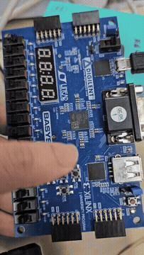

# Tick 기반 버튼 디바운싱과 LED 토글

[전체 프로젝트 목록](../README.md)

1 ms tick으로 버튼을 샘플링해 노이즈를 걸러 내고 한 번 누를 때 한 번만 LED를 반전합니다.

## 동작과 설계

```text
100 MHz → my_tick_generator(DIV=100_000) → 1 ms tick
btnU/btnD → sel 선택 → my_btn_debounce → my_led_toggle
```

`sel=1`이면 U, `sel=0`이면 D를 선택합니다. tick 시점에 기존 상태와 다른 입력이 10회 연속 관측되면 상태를 갱신합니다. 약 10 ms의 안정화 후 `clean_btn`이 바뀌고, 상승 에지에서 토글 LED를 한 번 반전합니다.

| 포트 | 의미 / 핀 |
| --- | --- |
| `reset` | active-high, SW0(V17) |
| `sel` | 버튼 선택, SW15(R2) |
| `btnU` / `btnD` | T18 / U17 |
| `led[0]` | 디바운싱된 버튼 상태 |
| `led[1]` | 항상 0 |
| `led[2]` | 누를 때마다 반전, 해제 시 유지 |
| `clean_btn` | 디바운싱 결과 별도 출력, J3 |

리셋 후 선택한 버튼을 길게 누르면 `led[0]`이 켜지고 `led[2]`가 한 번 바뀝니다. 떼면 `led[0]`만 꺼지고 다음 누름에서 `led[2]`가 다시 바뀝니다. 테스트벤치는 `DIV=100`으로 재정의하여 실행 시간을 줄입니다.

## 실행 구성

- **Design Top:** `top_my_btn_debounce`
- **Design Sources:**
  - [top_my_btn_debounce.v](sources_1/top_my_btn_debounce.v)
  - [u_my_tick_generator.v](sources_1/u_my_tick_generator.v)
  - [my_btn_debounce.v](sources_1/my_btn_debounce.v)
  - [my_led_toggle.v](sources_1/my_led_toggle.v)
- **보드 제약:** [Basys 3 XDC](constrs_1/Basys3-Master_orginal.xdc)

Vivado 프로젝트 생성과 합성·보드 실행 절차는 [공통 실행 방법](../README.md#실행-방법)을 따릅니다. 위 소스만 Design Sources에 추가하고 테스트벤치는 Simulation Sources에 분리합니다.

## 시뮬레이션

| 테스트벤치 | Simulation Top | 확인 범위 / 상태 |
| --- | --- | --- |
| [tb_my_btn_debounce.v](sim_1/tb_my_btn_debounce.v) | `tb_top_my_btn_debounce` | 노이즈, 첫 누름, 해제, 두 번째 누름과 최종 해제 검사 |

## 보고서와 시연 자료

GIF로 동작을 미리 보고, MP4로 전체 영상과 소리를 확인할 수 있습니다.

| 자료 | 파일명 |
| --- | --- |
| [구현 보고서 (열기 오류)](docs/report-original.pdf) | `my_btn_debounce_곽혜민.pdf` |
| [버튼 디바운싱 시연 영상](media/demo.mp4?raw=true) | `my_btn_debounce_동작 동영상.mp4` |

[](media/demo.mp4?raw=true)

## 현재 상태와 주의사항

`sim_1/my_btn_debounce.v`도 같은 테스트벤치 모듈명을 정의하므로 시뮬레이션 목록의 `tb_my_btn_debounce.v`만 추가합니다. PDF 파일에 열기 오류가 있어 재내보내기가 필요합니다.
