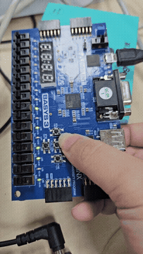

# 실행·정지 가능한 16비트 자동 카운터

[전체 프로젝트 목록](../README.md)

버튼으로 실행 상태를 전환하고 정지 상태에서 값을 초기화합니다.

## 동작과 설계

```text
btnU / btnD → 10 ms debouncer → 상승 에지 검출 → RUN/STOP 제어
100 MHz → 1,000,000클럭 카운트 → 10 ms마다 +1 → led[15:0]
```

| 입력 | 동작 |
| --- | --- |
| `reset=1` | LED와 내부 카운터를 0으로 초기화하고 RUN으로 복귀 |
| U 누름 | RUN ↔ STOP 전환 |
| STOP 중 D 누름 | 값 초기화, STOP 유지 |
| RUN 중 D 누름 | 값에 영향 없음 |

LED는 16비트 이진수이며 65,535 다음에는 0으로 순환합니다. 정지 시 분주 카운터는 0으로 돌아가고 표시 값은 유지됩니다. SW0(V17)로 리셋하고 U(T18)로 증가/정지를 확인한 뒤, 정지 상태에서 D(U17)를 눌러 초기화를 확인합니다. 입력 클럭은 W5, 100 MHz입니다.

## 실행 구성

- **Design Top:** `top_my_up_counter`
- **Design Sources:**
  - [top_my_up_counter.v](sources_1/top_my_up_counter.v)
  - [btn_debounce.v](sources_1/btn_debounce.v)
  - [up_counter.v](sources_1/up_counter.v)
- **보드 제약:** [Basys 3 XDC](constrs_1/Basys3-Master_orginal.xdc)

Vivado 프로젝트 생성과 합성·보드 실행 절차는 [공통 실행 방법](../README.md#실행-방법)을 따릅니다. 위 소스만 Design Sources에 추가하고 테스트벤치는 Simulation Sources에 분리합니다.

## 시뮬레이션

전용 테스트벤치가 포함되어 있지 않습니다.

문서 작성 과정에서 시뮬레이션을 새로 실행하지 않았습니다. PASS/FAIL 문구는 테스트벤치가 기대하는 결과이며 실제 재실행 결과와 구분합니다.

## 보고서와 시연 자료

제공받은 구현 자료의 사본입니다. PDF·영상이 현재 RTL과 동일한 버전인지까지 대조 검증한 것은 아닙니다. 영상 미리보기는 전체 영상의 움직이는 GIF입니다. MP4는 브라우저 호환성을 위해 H.264/AAC로 변환했으며, 원본 파일은 저장소 밖의 제공 위치에 보존되어 있습니다.

| 자료 | 제공 원본명 |
| --- | --- |
| [카운터 구현 보고서](docs/report.pdf) | `my_up_counter_곽혜민.pdf` |
| [카운터 시연 영상](media/demo.mp4?raw=true) | `my_up_counter_ 동작동영상.mp4` |

[](media/demo.mp4?raw=true)

## 현재 상태와 주의사항

현재 전용 테스트벤치는 없습니다. 보고서와 보드 영상은 기존 구현 자료입니다. 자동 검증을 추가한다면 증가 주기, 정지 중 값 유지, 정지 중 초기화, 최대값 순환을 검사할 수 있습니다.
